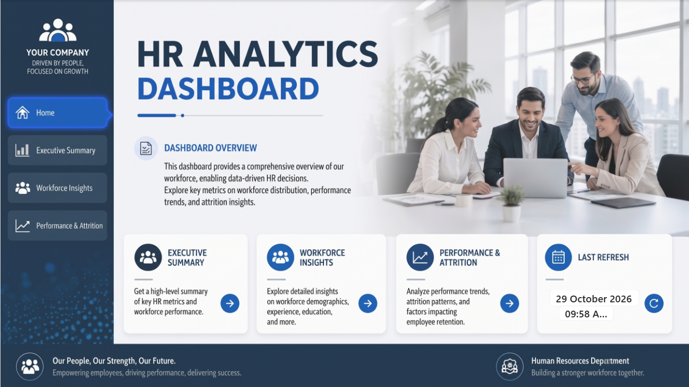
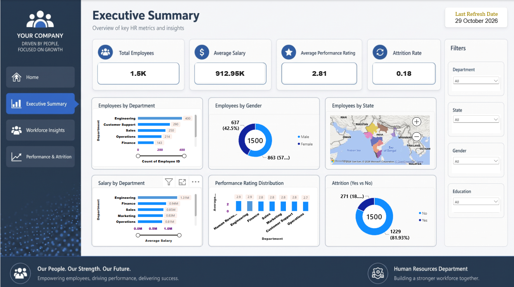
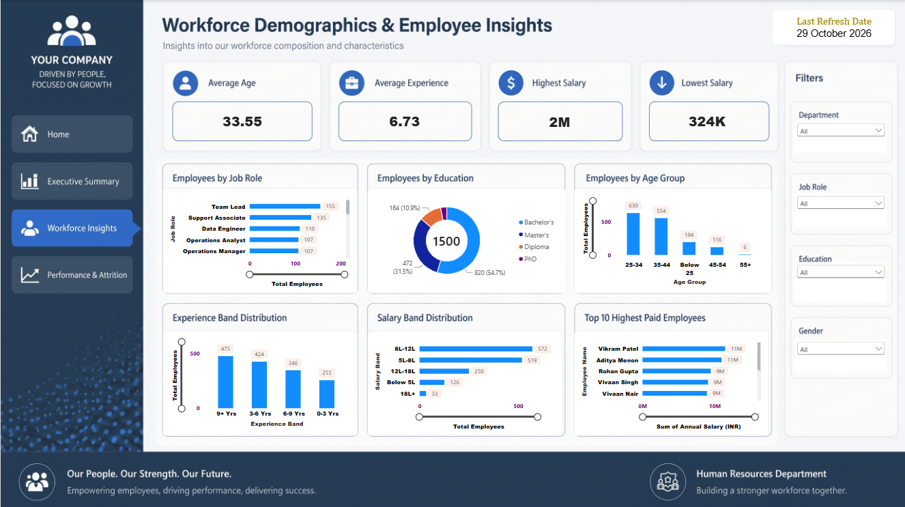
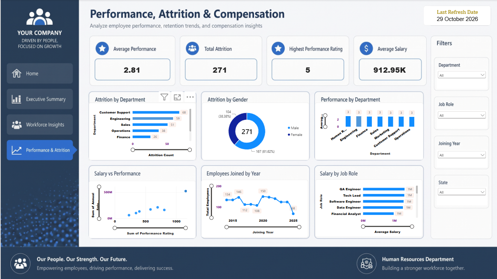

# 📊 HR Analytics Dashboard

An interactive **Power BI** dashboard that turns raw HR data into clear, actionable insights on workforce composition, compensation, performance, and employee attrition.


---

## 📑 Table of Contents

- [Project Overview](#-project-overview)
- [Business Objectives](#-business-objectives)
- [Dashboard Pages](#-dashboard-pages)
- [Key Metrics](#-key-metrics)
- [Key Insights](#-key-insights)
- [Dataset](#-dataset)
- [Tools & Technologies](#-tools--technologies)
- [Data Model & DAX](#-data-model--dax)
- [Project Structure](#-project-structure)
- [How to Use](#-how-to-use)
- [Future Improvements](#-future-improvements)
- [Author](#-author)

---

## 🔎 Project Overview

This project analyzes a workforce of **1,500 employees** across multiple departments, job roles, and states. The dashboard helps HR teams and leadership understand:

- Who makes up the workforce (demographics, education, experience)
- How compensation is distributed
- How employees are performing
- Where and why attrition is happening

The report is organized into a **Home / Navigation page** and **three analytical pages**, each with slicers for quick drill-down.

---

## 🎯 Business Objectives

- Provide a high-level **executive snapshot** of HR health
- Understand **workforce demographics** (age, gender, education, experience)
- Analyze **salary distribution** across departments, job roles, and bands
- Track **performance ratings** and their relationship with compensation
- Identify **attrition hotspots** by department and gender
- Support data-driven decisions on hiring, retention, and compensation

---

## 🖥️ Dashboard Pages

### 1️⃣ Home
A landing page with navigation to every report page and the last data refresh date.



### 2️⃣ Executive Summary
High-level KPIs with breakdowns by department, gender, state, performance, and attrition.



### 3️⃣ Workforce Demographics & Employee Insights
Deep dive into job roles, education, age groups, experience bands, salary bands, and top earners.



### 4️⃣ Performance, Attrition & Compensation
Analysis of attrition patterns, performance by department, salary vs. performance, hiring trend, and pay by job role.



---

## 📌 Key Metrics

| Metric | Value |
|---|---|
| Total Employees | **1,500** |
| Average Salary | **₹912.95K** |
| Average Performance Rating | **2.81 / 5** |
| Total Attrition | **271** |
| Attrition Rate | **~18%** |
| Average Age | **33.55 years** |
| Average Experience | **6.73 years** |
| Highest / Lowest Salary | **₹2M / ₹324K** |

---

## 💡 Key Insights

**Workforce**
- **Engineering** is the largest department (400 employees), followed by Customer Support (290) and Sales (250).
- The workforce is **57.5% male** and **42.5% female**.
- **54.7%** of employees hold a Bachelor's degree, **31.5%** a Master's.
- The workforce is young: most employees are aged **25–44** (1,184 of 1,500).
- **Team Lead** is the most common job role (155), followed by Support Associate (135).

**Compensation**
- **Engineering** has the highest average salary (~1.31M), well ahead of Finance (~0.94M) and Sales (~0.85M).
- The most common salary bands are **8L–12L (572)** and **5L–8L (519)**; only **33** employees earn above 18L.

**Performance**
- Average performance is consistent across departments (**~2.7 – 2.9**), showing no major department-level gaps.

**Attrition**
- **271 employees (18.07%)** have left the company.
- **Customer Support (68)**, **Engineering (59)** and **Sales (51)** have the highest attrition counts.
- Male employees account for **61.6%** of attrition (167), female employees **38.4%** (104).
- Hiring peaked around **2020 (~150 hires)** and has declined in recent years.

> ⚠️ Insights are based on the data shown in the dashboard and should be validated against the full dataset.

---

## 🗂️ Dataset

- **File:** `HR_Dataset_India.xlsx`
- **Records:** 1,500 employees
- **Currency:** INR (₹)
- **Typical fields:** Employee ID, Name, Gender, Age, Department, Job Role, Education, State, Years of Experience, Annual Salary, Performance Rating, Attrition (Yes/No), Joining Date

> The dataset is used for learning and portfolio purposes. If it is synthetic or anonymized, mention it here.

---

## 🛠️ Tools & Technologies

| Tool | Purpose |
|---|---|
| **Power BI Desktop** | Dashboard design & visualization |
| **Power Query** | Data cleaning & transformation |
| **DAX** | Measures & calculated columns |
| **Excel** | Source data (`HR_Dataset_India.xlsx`) |
| **GitHub** | Version control & portfolio hosting |

---

## 🧮 Data Model & DAX

**Calculated columns / groupings** (examples)
- Age Group: `Below 25`, `25-34`, `35-44`, `45-54`, `55+`
- Experience Band: `0-3 Yrs`, `3-6 Yrs`, `6-9 Yrs`, `9+ Yrs`
- Salary Band: `Below 5L`, `5L-8L`, `8L-12L`, `12L-18L`, `18L+`
- Joining Year

**Sample measures**

```DAX
Total Employees = COUNT ( Employees[Employee ID] )

Average Salary = AVERAGE ( Employees[Annual Salary] )

Average Performance Rating = AVERAGE ( Employees[Performance Rating] )

Total Attrition =
CALCULATE ( COUNT ( Employees[Employee ID] ), Employees[Attrition] = "Yes" )

Attrition Rate = DIVIDE ( [Total Attrition], [Total Employees] )
```

> Adjust table and column names to match your model.

---

## 📁 Project Structure

```
hr-analytics-dashboard/
│
├── screanshot/
│   ├── executive_summary.png
│   ├── home.png
│   ├── performance_attrition.png
│   └── workforce_insights.png
├── HR Dashboard.pbix               # Power BI report file
├── HR_Dataset_India.xlsx           # Source dataset
└── README.md
```

---

## 🚀 How to Use

1. **Clone the repository**
   ```bash
   git clone https://github.com/DimuthuMadhawa/hr-analytics-dashboard.git
   ```
2. Install [Power BI Desktop](https://powerbi.microsoft.com/desktop/) (free).
3. Open `HR Dashboard.pbix`.
4. If prompted, point the data source to `HR_Dataset_India.xlsx`: **Home → Transform data → Data source settings**.
5. Click **Refresh** and use the slicers (Department, State, Gender, Education, Job Role, Joining Year) to explore.

---

## 🔮 Future Improvements

- Display Attrition Rate as a percentage (e.g., 18.07%) instead of a decimal
- Add attrition-reason and tenure analysis
- Add gender pay-gap and promotion analysis
- Include forecasting for headcount and attrition
- Publish to Power BI Service with scheduled refresh
- Add Row-Level Security (RLS) for department heads

---

## 👤 Author

**Dimuthu Madhawa**

- GitHub: [@DimuthuMadhawa](https://github.com/DimuthuMadhawa)
- LinkedIn: [Dimuthu Madhawa](https://www.linkedin.com/in/dimuthu-madhawa-45809833b/)

⭐ If you found this project useful, please consider giving it a star!
